<!-- ============================================================
     DSR001915 // PROFILE.SYS — cyan HUD circuit theme
     All animated graphics live in /assets (self-contained SVG).
     ============================================================ -->

<p align="center">
  <a href="https://devanshsinghraghuvanshi0019.netlify.app/">
    
  </a>
</p>

<p align="center">
  
</p>

<p align="center">
  
  <a href="https://github.com/DSR001915?tab=followers"></a>
  <a href="https://devanshsinghraghuvanshi0019.netlify.app/"></a>
</p>

<!-- ============================ 01 ABOUT ============================ -->

<table>
  <tr>
    <td width="58%" valign="top">

```python
class Devansh:
    role      = "AI/ML & DevOps Engineer"
    location  = "New Delhi, India 🇮🇳"
    now       = "AI/ML & DevOps Intern @ NeGD, MeitY"

    building  = ["myScheme AI chatbot",
                 "SpeakDocs: Voice AI + RAG",
                 "OneClickCreate: meeting automation"]

    learning  = ["LangGraph agents", "MLOps",
                 "Cloud-native AI"]

    stack = {
        "ai":      ["scikit-learn", "PyTorch", "NLP", "RAG"],
        "backend": ["FastAPI", "Flask", "REST"],
        "data":    ["Pandas", "MongoDB", "SQL"],
        "devops":  ["Docker", "Linux", "CI/CD"],
    }
```

- 🔭 **Working on:** the Government of India's **myScheme** platform — MongoDB analysis and an AI/ML chatbot
- 🌱 **Learning:** LangGraph agents, MLOps and cloud-native AI
- 👯 **Open to collaborate on:** RAG, NLP and automation projects
- 📫 **Reach me:** [dsraghuvanshi2002@gmail.com](mailto:dsraghuvanshi2002@gmail.com)
- ⚡ **Fun fact:** I debug with `print()` and a cup of chai ☕

> *“Turning data into models, and models into products.”*

</td>
    <td width="42%" valign="top" align="center">
      
    </td>
  </tr>
</table>

<!-- ============================ 02 CONNECT ============================ -->

<p align="center">
  <a href="https://www.linkedin.com/in/devansh-raghuvanshi-30b578231/"></a>
  <a href="mailto:dsraghuvanshi2002@gmail.com"></a>
  <a href="https://devanshsinghraghuvanshi0019.netlify.app/"></a>
  <a href="https://github.com/DSR001915"></a>
  <a href="https://devanshsinghraghuvanshi0019.netlify.app/DevanshResume_AI_ML_DevOps.pdf"></a>
</p>

<!-- ============================ 03 TECH STACK ============================ -->

<p align="center">
  <br>
  
</p>

<p align="center">
  
  
  
  
  
  
  
  
  
  
  
  <br>
  
  
  
  
  
</p>

<!-- ============================ 04 PROJECTS ============================ -->

<table>
  <tr>
    <td width="50%"><a href="https://github.com/DSR001915/docutrust"></a></td>
    <td width="50%"><a href="https://zenith-study-planner.vercel.app"></a></td>
  </tr>
  <tr>
    <td width="50%"><a href="https://github.com/DSR001915/Customer-churn-prediction-system"></a></td>
    <td width="50%"><a href="https://github.com/DSR001915/pneumoniadetection"></a></td>
  </tr>
  <tr>
    <td width="50%"><a href="https://github.com/DSR001915/Face-recognition-attendance-service"></a></td>
    <td width="50%"><a href="https://devanshsinghraghuvanshi0019.netlify.app/"></a></td>
  </tr>
</table>

<p align="center"><sub>▸ Click any card to open the repository or live demo · <a href="https://github.com/DSR001915?tab=repositories">all repositories</a></sub></p>

<!-- ============================ 05 EXPERIENCE ============================ -->

| 🛰️ | Role / credential | Where | When |
|:--:|:--|:--|:--|
| 🏛️ | **AI/ML & DevOps Intern** | National e-Governance Division (NeGD), MeitY | Aug 2026 – Present |
| 🤖 | **AI & Machine Learning Intern** | Venura Tech | May – Jun 2026 |
| ♾️ | [**IBM DevOps and Software Engineering**](https://coursera.org/verify/professional-cert/W8SKG784LVL3) | Professional Certificate · Coursera | ✔ Verified |
| ☁️ | [**AWS Cloud Solutions Architect**](https://coursera.org/verify/professional-cert/VEMOXCV6LWKO) | Professional Certificate · Coursera | ✔ Verified |
| 🎓 | **B.E. Computer Science & Engineering** | Chandigarh University · CGPA 8.28 / 10 | 2021 – 2025 |

<!-- ============================ 06 ANALYTICS ============================ -->

<p align="center">
  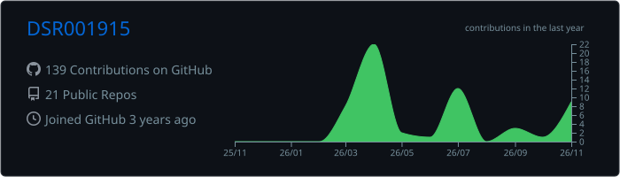
</p>
<p align="center">
  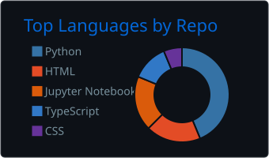
  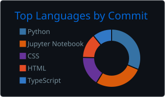
</p>
<p align="center">
  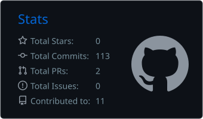
  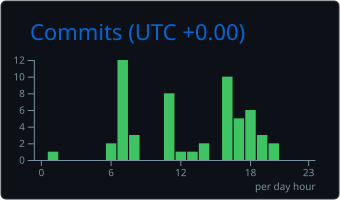
</p>
<p align="center">
  
</p>

<!-- ============================ 07 TROPHIES ============================ -->

<p align="center">
  
</p>

<!-- ============================ 08 SNAKE ============================ -->

<p align="center">
  <picture>
    <source media="(prefers-color-scheme: dark)" srcset="https://raw.githubusercontent.com/DSR001915/DSR001915/output/github-snake-dark.svg">
    <source media="(prefers-color-scheme: light)" srcset="https://raw.githubusercontent.com/DSR001915/DSR001915/output/github-snake.svg">
    
  </picture>
</p>


<p align="center">
  <code>&gt; connection terminated · thanks for visiting · ⭐ a repo if something helped you</code>
</p>
